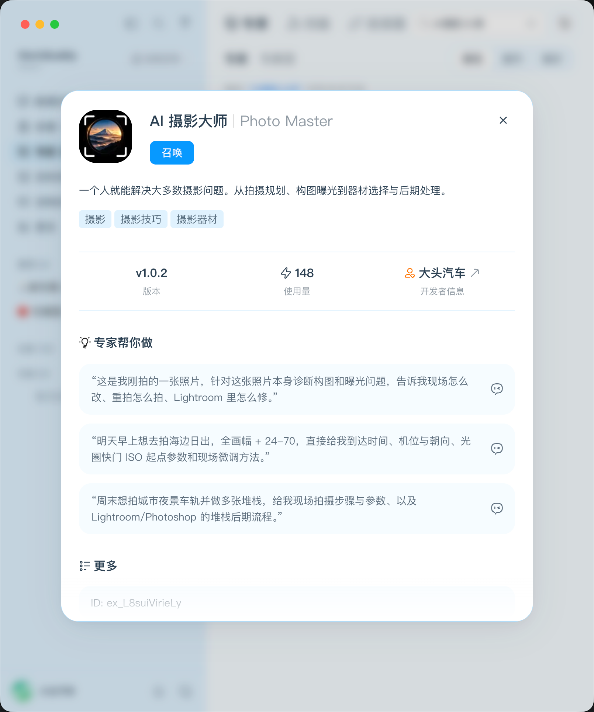
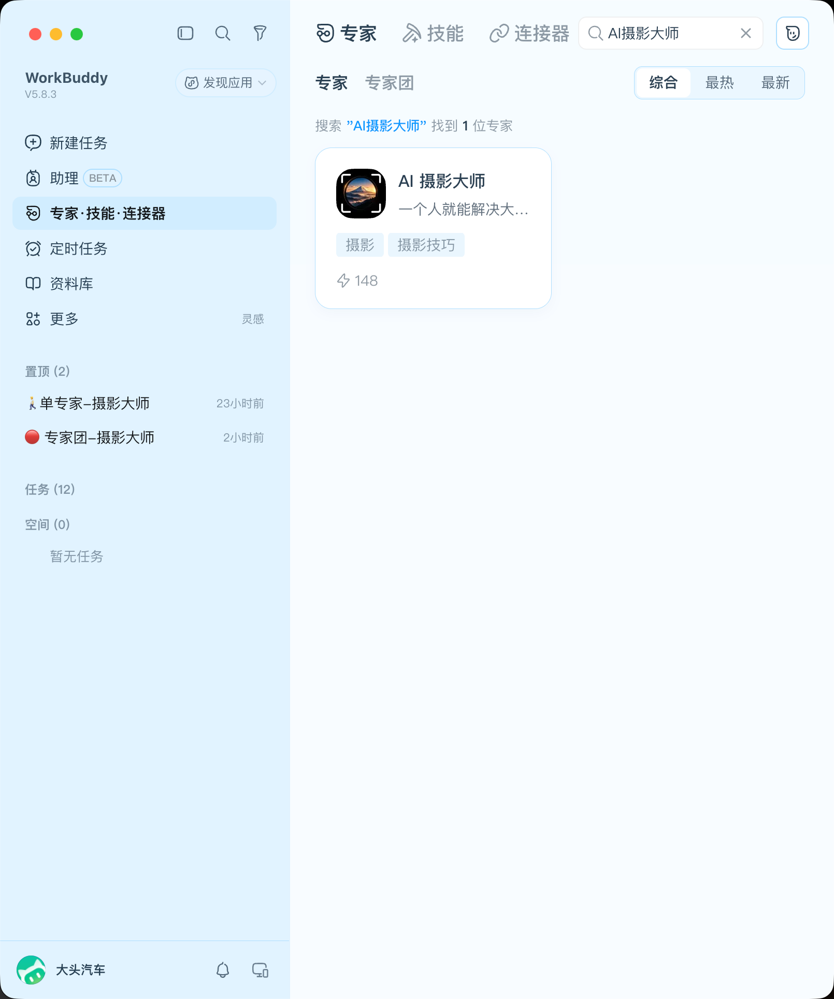
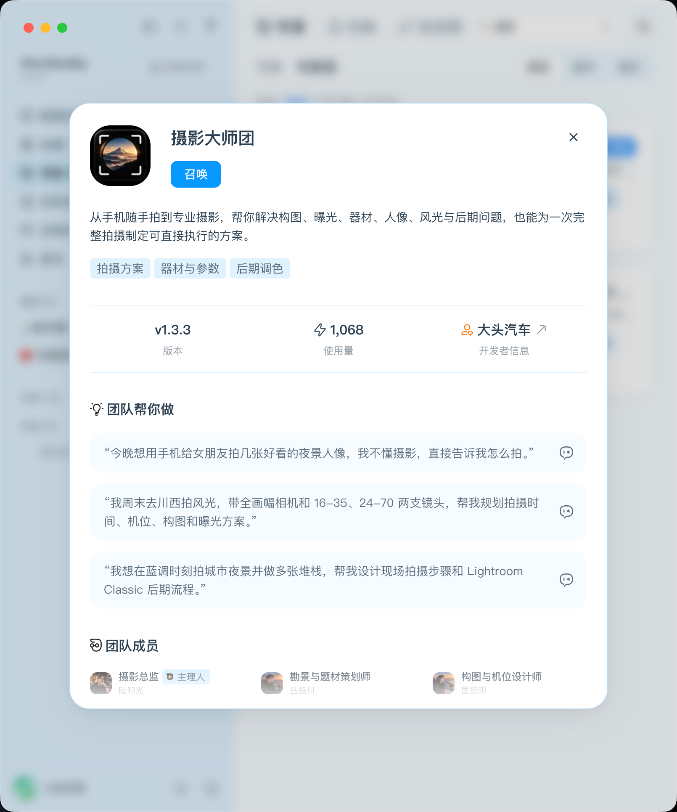
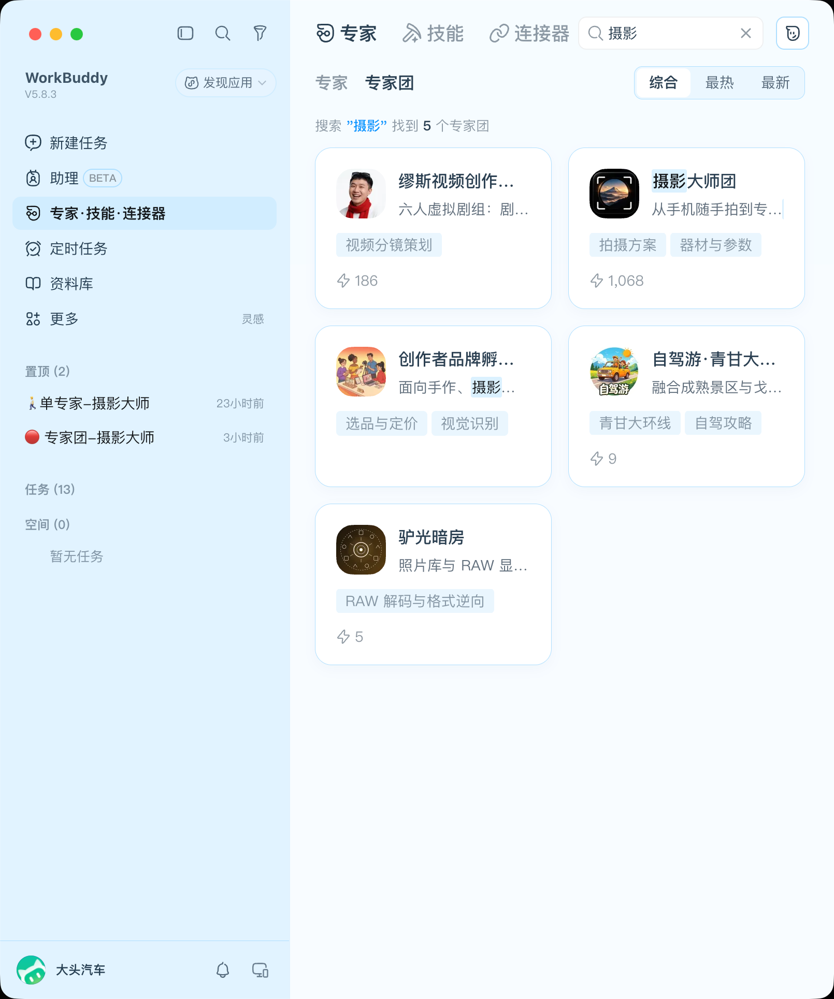

# AI Native Product Leader

### AI 原生产品负责人 · AI 产品战略 · Agent 产品 · Vibe Coding

**中文**

具备多年互联网及企业级软件产品管理经验，覆盖产品战略、产品规划、用户体验、研发协作与产品商业化。

近年来聚焦 AI Native 产品创新与实践，探索大语言模型、AI Agent 及 Vibe Coding 在真实业务场景中的应用，并独立完成单 Agent 与多 Agent 两种形态的 AI 产品开发实践。

**English**

Experienced product leader with a background in internet and enterprise software products, spanning product strategy, planning, user experience, cross-functional delivery, and commercialization.

Focused on AI-native product innovation, with hands-on experience building single-agent and multi-agent products using AI-assisted development tools.

---

## 01｜核心能力 · Core Competencies

**AI Native 产品设计 | AI-Native Product Design**

从真实用户需求出发，开展 AI 产品规划、需求定义、体验设计及产品交付。

Translate user needs into AI-native product strategies, requirements, user experiences, and deliverable solutions.

**Agent 产品实践 | AI Agent Development**

具备单 Agent 与多 Agent 产品的规划、设计和实际开发经验。

Hands-on experience planning, designing, and building single-agent and multi-agent products.

**Vibe Coding | AI-Assisted Development**

使用 AI 辅助开发工具推进产品构建、功能实现、测试验证及持续迭代。

Leverage AI-assisted development tools to build, test, and iteratively improve functional products.

**产品领导力 | Product Leadership**

具备产品全生命周期管理经验，关注产品价值、用户体验、交付质量与业务成果。

Experienced in end-to-end product management, with a focus on customer value, user experience, delivery quality, and business outcomes.

---

## 02｜代表作品 · Featured Projects

### 📷 AI 摄影大师 | Photo Master

**AI Native · Single-Agent · Vibe Coding**

**中文**

面向摄影爱好者与专业摄影用户的 AI 摄影辅助产品，提供摄影知识咨询、拍摄建议与创作辅助服务。

**English**

An AI-native photography assistant designed for enthusiasts and professional photographers, providing photography guidance, shooting recommendations, and creative support.

**个人职责 | My Role**

**中文**

独立负责 AI Native 摄影产品从需求分析、产品规划到上线交付的完整过程。

基于真实摄影场景设计 AI Agent 产品体验，通过 Vibe Coding 完成产品开发、功能验证与持续迭代，并推动产品在 WorkBuddy 平台上线。

**English**

Led the end-to-end development of an AI-native photography product, from user needs analysis and product planning to launch.

Designed the AI Agent product experience around real-world photography scenarios, using Vibe Coding for hands-on development, functional validation, and iterative improvement. Successfully launched the product on WorkBuddy.

**产品展示 | Product Showcase**

**产品介绍页 | Product Overview**

**平台搜索结果 | Platform Search Results**

---

### 📷 摄影大师团 | Photo Masters

**AI Native · Multi-Agent · Vibe Coding**

**中文**

面向复杂摄影需求的多专家协作 AI 产品，提供综合性的摄影咨询与创作辅助服务。

**English**

An AI-native multi-agent photography product designed to support complex photography needs through collaborative expert assistance.

**个人职责 | My Role**

**中文**

独立负责 AI Native 多专家协作摄影产品从需求分析、产品规划、架构设计到上线交付的完整过程。

设计由 1 名摄影总监与 6 名专业摄影专家组成的多 Agent 协作体系，围绕任务识别、专家分工、动态调度与结果整合，构建面向复杂摄影场景的协作工作流。

通过 Vibe Coding 完成产品开发、功能验证与持续迭代，重点优化专家协作效率、任务执行稳定性及专业建议的一致性，并推动产品在 WorkBuddy 平台上线。

**English**

Led the end-to-end development of an AI-native multi-agent photography product, from requirements analysis and product strategy to architecture design and launch.

Designed a collaborative multi-agent system consisting of one photography director and six specialized experts, establishing workflows for task identification, expert coordination, dynamic orchestration, and response synthesis.

Used Vibe Coding for hands-on product development, functional validation, and continuous iteration, focusing on collaboration efficiency, execution reliability, and consistency of professional recommendations. Successfully launched the product on WorkBuddy.

**产品展示 | Product Showcase**

**产品介绍页 | Product Overview**

**产品介绍页 | Product Overview**

**平台搜索结果 | Platform Search Results**

---

## 03｜AI 产品实践与交付 · AI Product Development & Delivery

**中文**

通过 AI 辅助开发工具，探索产品经理直接参与软件开发的新型工作模式。

已完成单 Agent 与多 Agent 两类 AI Native 产品的实际开发实践，覆盖产品定义、功能实现、测试验证及版本迭代。

**English**

Exploring AI-assisted software development as a practical approach for product managers to participate directly in product implementation.

Hands-on experience delivering single-agent and multi-agent AI-native products, covering product definition, implementation, testing, and iteration.

**实践方向 | Areas of Practice**

`AI Native` · `LLM` · `AI Agents` · `Multi-Agent Systems` · `Vibe Coding` · `Product Strategy`

---

## 04｜关于本作品集 · About This Portfolio

**中文**

本 GitHub 主页用于展示个人 AI 产品管理能力、AI Native 产品实践经历及代表性项目成果。

部分项目为非开源产品，因此不公开核心源代码、Prompt、Skills、内部配置及其他专有技术资料。

**English**

This GitHub profile highlights my experience in AI product management, AI-native product development, and selected project outcomes.

Some projects are proprietary. Source code, prompts, skills, internal configurations, and other implementation details are not publicly disclosed.

---

## 05｜联系与交流 · Contact

**GitHub:** https://github.com/ddqc118

欢迎就 AI 产品管理、AI Native 产品创新及 Agent 产品实践进行专业交流。

Open to professional discussions about AI product management, AI-native innovation, and agent-based products.
